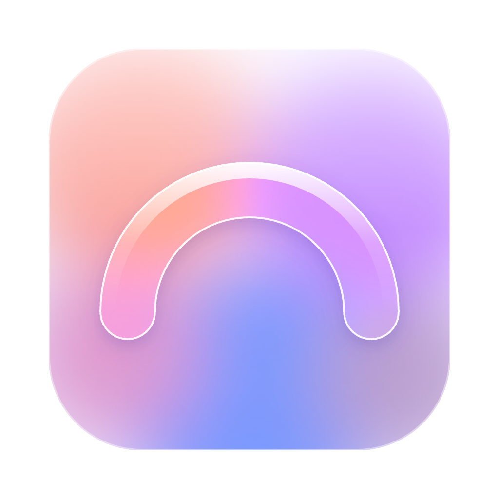
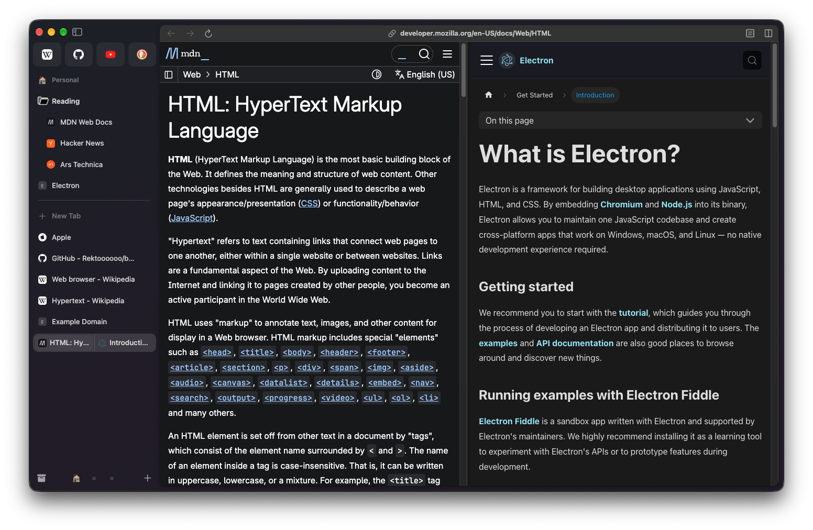
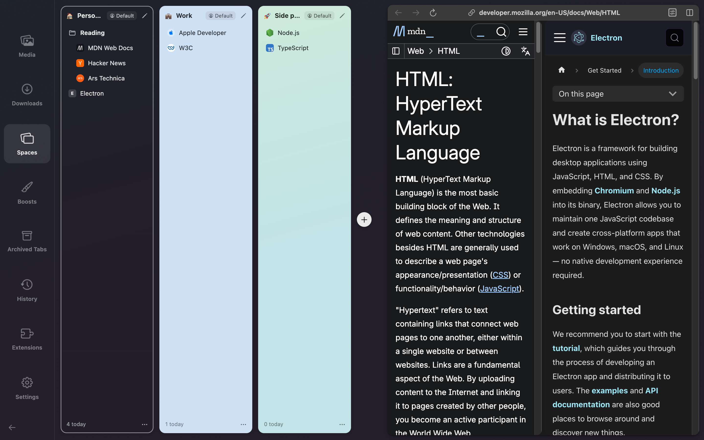
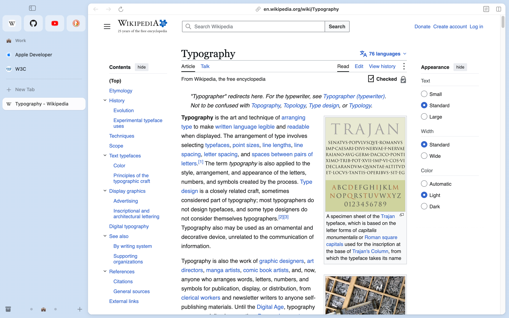

<p align="center">
  
</p>

<h1 align="center">Bow</h1>

<p align="center">
  <b>An open-source browser in the spirit of Arc, for macOS.</b><br>
  Tabs in a vertical sidebar, Spaces, Favorites, Peek, Split View, Little Windows and tabs that tidy themselves away.
</p>

<p align="center">
  <a href="https://github.com/Rektoooooo/bow/releases/latest"><b>Download for Mac</b></a> ·
  <a href="#what-works">Features</a> ·
  <a href="#build-it-yourself">Build it yourself</a> ·
  <a href="CONTRIBUTING.md">Contribute</a>
</p>

<p align="center">
  <a href="https://github.com/Rektoooooo/bow/releases/latest"></a>
  <a href="https://github.com/Rektoooooo/bow/actions/workflows/ci.yml"></a>
  
  <a href="LICENSE"></a>
</p>


## Why Bow

Arc is being shut down. Bow keeps the way of browsing that made it special: the sidebar is your whole browser, every
Space has its own colours and tabs, and tabs you stop using move to the archive by themselves. Bow is built with
Electron and TypeScript, so every page runs on Chromium, and Chrome extensions work.

Before Arc goes, we studied how it behaves (from its app bundle and the files it writes; see
[docs/research](docs/research)) and rebuilt that behavior in our own code. No Arc code, icons or assets are used.
Bow is not affiliated with or endorsed by The Browser Company; Arc is their product and trademark. (A bow is another
word for an arc.)

<table>
  <tr>
    <td width="50%"><br><sub><b>Command Bar</b> (⌘T): open tabs, history, search and browser actions.</sub></td>
    <td width="50%"><br><sub><b>Split View</b>: drop a tab on another tab to put them side by side.</sub></td>
  </tr>
  <tr>
    <td width="50%"><br><sub><b>Spaces</b>: each with its own theme, pinned tabs and profile.</sub></td>
    <td width="50%"><br><sub><b>Light and dark</b>: a Space's theme colours the whole window.</sub></td>
  </tr>
</table>

## Install

1. Download **Bow-…-arm64.dmg** from the [latest release](https://github.com/Rektoooooo/bow/releases/latest).
   Bow runs on Macs with Apple silicon (M1 or newer) and macOS 13 or later.
2. Open the disk image and drag **Bow** to **Applications**. Bow is signed and notarized by Apple, so it opens
   without warnings.
3. To make it your everyday browser, choose **Bow › Set as Default Browser…** (or type "default" in the Command
   Bar). Links from other apps then open in a Little Window, or in a Space when an Air Traffic Control rule matches.

**Coming from Arc?** **File › Import from Arc…** reads Arc's files on this Mac (read-only) and adds your Spaces,
Favorites, pinned folders and tabs, Today tabs, Space themes, Arc's cached icons, your archive (newest 250), your
browsing history and your Chrome Web Store extensions (copied, so they survive Arc; each keeps the on/off it had in
Arc). Running it twice adds nothing twice. Chrome, Brave, Edge, Vivaldi, Firefox and Safari can be imported too
(Library › Settings).

**Never locked in.** **File › Export Bow Backup…** writes everything that makes your setup yours (Spaces, pinned tabs
and folders, Favorites, Today tabs, Notes, Easels, Boosts, Air Traffic Control rules and settings) to one open JSON file
([format](docs/backup-format.md)). **File › Restore from Backup…** puts a backup in place of your setup (Bow keeps a
copy of the current one first) or adds its Spaces next to yours. A restored file is checked like untrusted input:
only web, note and easel addresses get in, and JavaScript Boosts arrive switched off. While Bow is in use, it also
keeps automatic copies every hour (the last 12 hours, then one a day for a week) in its Backups folder, where Restore…
opens; Library › Settings › Backup turns them off.

**Sync without an account.** Library › Settings › Sync › Choose Folder… syncs Spaces, pinned tabs, folders,
Favorites, Notes, Easels, Boosts and rules between your Macs through a folder they all reach, such as iCloud Drive or
Dropbox. Each Mac keeps one file there and reads the others'; a change merges piece by piece, so renaming a tab on one
Mac and pinning a page on another keeps both. Today tabs, the Archive and settings stay on each Mac
([how it works](docs/sync.md)).

Bow keeps itself up to date: a few times a day it looks for a new release here on GitHub, downloads it in the
background, and the sidebar says **Update ready**. Click **Restart**, or just quit Bow; the new version is there the
next time it opens. **Bow › Check for Updates…** looks right away. The check downloads a small file from this
repository's releases and sends nothing about you.

## Build it yourself

```bash
nvm use        # Node 24 (see .nvmrc)
npm install
npm start      # builds, then opens Bow
npm test       # unit tests (Vitest)
npm run e2e    # drives the real app with Playwright (opens windows for a few minutes; throwaway profiles)
```

`npm run package` builds **release/Bow-darwin-arm64/Bow.app**, signed ad hoc for your own Mac. `npm run release`
builds a release's files: the signed, notarized disk image, the zip and the feed that installed copies update from
(it needs a Developer ID certificate and notarytool credentials; see the top of `tools/release-mac.sh`). A build from
source never updates itself.

## What works

**Sidebar**
- Favorites as tiles at the top, shared by every Space that uses the same profile (up to 12, like Arc). The selected
  one gets a border in the colour that appears most in its icon, like Arc's.
- A Space title (click to collapse Pinned), Pinned tabs and nested folders, a divider with **Clear**, **+ New Tab**,
  and the Today list. A closed folder still shows the tab you are on.
- A Pinned tab that left its page shows Arc's "/" (its menu has Back to Pinned URL). ⌘W on a Pinned tab puts its
  page away but keeps the tab.
- Drag and drop: reorder, pin, make a Favorite, drop into a folder, move to another Space, drop a tab on another
  tab to put them side by side, or drop a link to open it.
- Bottom bar: Library, the Space switcher (emoji for the active Space, dots for the others), and a **+** menu.
- ⌘S hides the sidebar; touching the window's left edge shows it again for a moment, as a floating panel like Arc's.
  Drag its edge to resize it. Icons fade while the window is in the background, text does not (Arc's look).
- **Compact Mode** (⌥⌘S) hides the sidebar and the toolbar (⇧⌘D hides only the toolbar): touching the window's left
  edge slides the sidebar in, its top edge the toolbar. **Focus Mode** (⇧⌘F) shows only the page, filling the
  window, until ⇧⌘F again. Each window has its own.
- A dot on a Pinned tab or Favorite whose page changed while you were elsewhere (a new mail count), like Arc.
- **Notes on tabs and folders** (their menu › Add Note…): a line of your own under the title, such as "Read before
  Friday", written in place; the whole note shows when you rest the pointer on the row.
- A small player for a tab playing sound in the background.
- Rest the pointer on a tab for Arc's tooltip (its title; "Double-click to rename" on the selected tab); ⌃Tab shows
  the recently used tabs as cards with pictures.
- Rest the pointer on a closed folder to see its tabs beside it, newest first ("1 minute ago"), with a search field,
  like Arc; click one to open it.
- Pinned tabs show tidy titles ("Inbox" rather than "(3) Inbox - Mail"), our own rules (Library › Settings).
- **Live folders** (+ › New Live Folder) fill themselves, like Arc's: your open GitHub pull requests, review
  requests, assigned issues, issues you opened or notifications (read from github.com with the Space's own GitHub
  sign-in: no token, private repositories included); the issues of the Jira filter or Linear list on screen (Issues
  from This Page, read the same way with your sign-in there); the posts of the page's RSS/Atom feed (a subreddit
  works too), or Hacker News in one click. They refresh every 10 minutes; a folder that needs you to sign in says so
  and refills once you visit the site; new items get a dot, items you remove stay hidden (folder menu › Show
  Removed Items), the page you are reading never disappears. An Arc import keeps Arc's GitHub live folder live.
- Like Arc, the frame is darker while the window is active and lighter grey in the background (measured on the
  real screen against the user's Arc).
- The look is measured from Arc pixel by pixel (`node e2e/arc-compare.mjs` puts them side by side): Apple's SF
  Symbols, Arc's frame colors from a Space's theme and intensity, the toolbar inside the page card tinted with the
  page's own color, and motion that glides (the page moves with the sidebar).

**Spaces and profiles**
- Create, rename, change the icon (Space menu › Change Space Icon…: Arc's popover over the Space's button, with an
  Emoji tab and an Icon tab of SF Symbols), edit the theme (Space menu › Edit Theme…: Arc's popover beside the
  sidebar's bottom, a dotted pad with one handle per color (up to three), automatic / light / dark, preset colors,
  an intensity slider and a grain dial), reorder, delete. Two-finger swipe on the sidebar or ⌃1–⌃9 switches Spaces.
- Each profile has its own cookies, logins and Favorites (an Electron session partition). Space menu › Profile
  moves a Space to another profile or a new one.
- Each Space can have its own defaults (Space menu): **Search Engine** (Work searches with Google, the rest with
  DuckDuckGo) and **New Tab Opens** a page of its own (Use Current Page) instead of the Command Bar; ⌘L still opens
  the Command Bar there. They stay on each Mac, like the Space's archive timing.
- **Space templates**: Space menu › Save as Template keeps the Space's icon, theme, Pinned tabs and folders (a live
  folder keeps its source and fills itself again) and its own defaults; + › New Space from Template (or the Command
  Bar, or Library › Spaces) makes a new Space like it with fresh tabs. Notes and Easels are left out; templates are
  in backups and sync between your Macs.
- Private windows (⇧⌘N) keep nothing: an in-memory session, no history, no archive.

**Windows**
- File › New Window (⌘N) opens another full window, like Arc: the same Spaces, Favorites, Pinned and Today lists,
  but its own Space and its own selected tab in each Space. It opens on the Space you were in, with the Command Bar
  ready for a new tab.
- Each window has its own sidebar, like Arc: ⌘S, its width, and which Pinned sections and folders are open. A new
  window starts with the sidebar of the last window you closed (Arc's rule), and the folders of the window it came
  from.
- A page is on screen in one window at a time. Selecting a tab another window shows says "Open in another window",
  with **Move to This Window**. Notes and Easels too: one window edits them at a time, and moving one over keeps the
  last keystrokes.
- Drag a tab, folder or split from one window's sidebar into another's (Favorites, Pinned, Today, a folder, next to
  a split, or a Space button). A tab or split comes along: the other window selects it and its page moves over; the
  window it came from shows another of its tabs. On a Space button it only moves to that Space.
- Menus, shortcuts, the Command Bar, the Library, Peek and the other panels act in the window in front. ⇧⌘W closes a
  window; the app quits with the last one. Every window (place, size, Space, selection) opens again at the next
  start; links from Little Windows go to the main window you used last.

**Command Bar** (⌘T, ⌘L)
- Finishes addresses as you type ("git" → github.com, also well-known sites you never visited).
- Open tabs ("Switch to Tab"), history, what you typed, search suggestions and about 40 browser actions
  ("New Space", "Toggle Sidebar", "Copy URL", "Theme: Mint", …), ranked by how well title and address match plus
  boosts for open tabs, Favorites and recent use, the way Arc ranks.
- **Recently closed**: with nothing typed, the 3 tabs you closed last are listed below the recent ones; a closed tab
  that matches what you type is offered too. Return reopens it where it was (like ⇧⌘T, for any of them).
- **History by date**: type "yesterday", "monday", "last friday", "3 days ago", "this week" or "last week", alone or
  with words ("yesterday github"), for the pages you visited then, newest first, with the time of each visit.
- **Chains** (Library › Chains): several actions and pages in one command. Build "Morning" from "Switch to Work",
  "Open github.com/notifications" and "Toggle Sidebar", then type "morning" in the Command Bar to run them in order.
  A chain never runs another chain; chains are in backups and sync between your Macs.
- **Answers**: a sum ("12*7", "(3+4)^2", "sqrt(2)", "15%") or a unit conversion ("5 km in mi", "350 f to c",
  "2 cups in ml", "1 GiB in MB", "100 km/h to mph") is worked out on top as you type; Return copies the answer.
  Worked out on your Mac, so the text is not sent to the search engine (no currencies: their rates would need a
  server).

- **Tab to search a site**: type "youtube" (or "wiki", "gh", "maps", "claude", …), press Tab, type your search, Enter.
  Backspace in the empty field goes back. The sites and their search addresses are listed in
  `src/shared/siteSearch.ts`.

**Pages**
- **Reader view** (⌃⌘R, or the toolbar's page button on articles): the article without the site around it (menus,
  ads, sidebars) in one calm column, with its site, author and reading time; A− / A+ size the text, Escape or Done
  goes back to the page, which stayed loaded where it was. Bow's own extraction: the page's text comes in as plain
  text, never as markup.
- **Peek**: a link from a Pinned tab or Favorite to another site, or any Shift-clicked link, opens in a card that
  hangs from the window's top edge with its own back / forward / reload row, the page behind dimmed, like Arc's.
  ⌘O (or the round ↗ button) makes it a tab without reloading, Split puts it next to the page, Esc closes it.
- **Split View**: two to four tabs side by side, stacked, or in a 2×2 grid, one row in the sidebar. Drop a tab on the
  middle of another tab (or ⌃⇧=) to make one. Drag the line between panes to resize them (double-click it to make
  them equal again); Tabs › Split View has the layouts (⌃⌥⌘1 / 2 / 3), Swap Panes (⌃⌥⌘S) and Next / Previous Pane
  (⌃⌥⌘→ / ←).
- **Sleeping tabs**: a page you have not used for 30 minutes (Library › Settings: 15 minutes to 2 hours, or never)
  closes to free its memory, about 80 MB each, and wakes where you left it, scroll position, form values and Back
  included, when you go back; its tab fades meanwhile. Pages on screen, playing sound, in a call or sharing the screen
  stay awake, and so do Favorites (a switch) and any site you keep awake (Control Center, a tab's menu). Sleep Tab and
  Sleep Other Tabs free memory at once; **Tabs › Task Manager** shows what each awake page uses.
- **Little Window**: links from other apps (and ⌥⌘N) open in a small window; "Open in Space" moves the page into the
  sidebar. A Little Window left alone for 6 hours goes to the Archive.
- **Shortcut from any app** (Library › Settings, off until you pick keys such as ⌥Space): brings up the Command Bar,
  or a Little Window, without switching to Bow first. If another app holds the keys, Settings says so.
- **`bow://` addresses and Raycast**: other apps can open an address in a Space, switch Spaces, search the open tabs or
  open the Command Bar with text (`open "bow://open?url=github.com&space=Work"`). `integrations/raycast` has three
  Raycast script commands built on them (Open in Bow, Switch Bow Space, Search Bow Tabs); Alfred and Shortcuts can use
  the same addresses.
- **Boosts**: change a site's colors (shift them, or invert for a dark look) and font, Zap elements away, and add
  your own CSS and JavaScript (only once switched on). Turn a Boost off or reset it any time; Library › Boosts.
  Share one as a `.bowboost` file (Export…, Import…; imported JavaScript arrives switched off), and a "JS" badge in
  the toolbar says when a JavaScript Boost runs on the page.
- **Developer Mode** per site (on by itself for localhost): a striped toolbar with the full address, Console,
  Network and Inspect buttons, a reload menu with Hard Reload, and the tab outlined in yellow.
- **Show full URLs** (Library › Settings, View › Toggle Full URLs, or the Command Bar): the toolbar shows the whole
  address instead of site and path, like Arc's preference of the same name.
- **Notes** and **Easels**: rich-text notes and boards (text, drawing, pictures, captures) that sit in the sidebar
  like tabs (File › New Note / New Easel). A capture placed on an easel is live, like Arc's: it is taken again
  from its page (same size, scroll and region) when the easel opens, or when you click its **Live** badge.
- **Ad and tracker blocking** with EasyList and EasyPrivacy (off until you turn it on in Library › Settings), allowed
  per site in the Control Center.
- **Privacy report** (Library › Privacy): how many trackers the blocker stopped in the last 7 days, a bar per day, and
  the sites and tracker hosts with the most blocks, like Safari's report. Counts only, kept 30 days, never from
  private windows.
- **HTTPS-Only Mode** (Library › Privacy): pages asked for over http load over https. A site without a secure version
  says so in the sidebar, with "Open with HTTP" (allowed until Bow quits); a typed https:// address is never taken
  down to http, and local names and IP addresses stay as they are. Little Windows and Peek show the browser's error
  page instead of the offer.
- **Forget site data on quit**, per profile (Space menu › Profile, or Library › Privacy): cookies, sign-ins and what
  sites store are cleared every time Bow quits, and again at the next start should it crash. Extensions keep their own
  data; you sign in again each time.
- **Air Traffic Control**: rules such as "address contains github.com → Work" or "link comes from Slack → Work" send
  links from other apps to a Space (Library › Settings, which lists your running apps). The sender is the app in front
  when the link arrives, read with macOS's own `lsappinfo` (no permission needed). **Test a link** there shows where
  a pasted link would open, from any app or a chosen one.
- **Permission prompts**: a site that wants your camera, microphone, location, notifications or clipboard asks
  first ("meet.google.com wants to use your camera and microphone", Block / Allow). The answer is remembered per
  profile and site; the site controls list it with a Reset. Private windows ask every time and remember nothing.
  Links to apps (mailto:, zoommtg:, steam:, …) ask every time and name the app macOS would open. Sharing your
  screen (Meet, Zoom, Slack in the browser) opens macOS's own sharing picker, where you choose what to share.
- The **Control Center** (Arc's site controls): Share, Boost, Screenshot, Capture (drag over part of the page), the
  profile's extensions, per-site settings, and more behind "…" (Translate Page, zoom, clear site data, developer
  tools). Find in page,
  downloads, Print (⌘P), spelling suggestions, a right-click menu in pages, and automatic picture-in-picture when
  you leave a tab playing a video: the tab's own page floats in a small window of ours, the video filling it, with
  its title, Back to Tab, close, play / pause, mute and the progress showing while the pointer is over it. A video in
  an embedded player (a YouTube or Vimeo player inside an article) floats the same way.

**Extensions**
- Chrome extensions per profile, like Arc: imported from Arc, added from the Chrome Web Store (open an extension's
  page and click **Add Extension** in the toolbar), or loaded from a folder (Library › Extensions › Load Unpacked…).
  Web Store extensions update by themselves (a minute after start, then every 5 hours, or Check for Updates).
  Each download is checked like Chrome checks it: signed by the extension's own key, before anything is unpacked. Content scripts and Manifest V3 service workers run in Electron itself; the
  [electron-chrome-extensions](https://github.com/samuelmaddock/electron-browser-shell) library (MIT) adds the
  browser parts: the puzzle button in the toolbar opens an extension's popup, `chrome.tabs` knows the selected tab,
  extensions can open tabs, and their items appear in the page's right-click menu.
- Password managers' desktop links work (native messaging, e.g. Apple Passwords, 1Password, Bitwarden): hosts
  registered for Chrome are found directly, and those registered only for Arc, Brave, Edge, Vivaldi or Chromium are
  linked in at startup.
- Some extensions need Chrome features Electron does not have (side panels, tab capture); those load but only
  partly work.

**Library** (⇧⌘L): like Arc's, it takes the sidebar column (which widens for it) with a rail of sections: Media
(screenshots and captures), Downloads, Spaces, Boosts, Archived Tabs (search, filter by reason, click to restore),
History, Extensions and Settings (search engine: Google, DuckDuckGo, Bing, Brave Search or Kagi; ad blocking, app
icon, import from Arc, Chrome, Brave, Edge, Vivaldi, Firefox or Safari). The page stays usable beside it; ← or Esc closes it.

**Also**: a short welcome tour on the first start, Handoff of the page you are reading to your other Apple devices,
and alternate app icons for the Dock.

## Auto-archive, like Arc

A Today tab you have not used for 12 hours (the default; 1 hour to 30 days, or never) moves to the Archive. Pinned
tabs and Favorites never do. A tab counts as used while it is on screen, playing sound or in Picture-in-Picture.
These timings match what we measured on a real Arc install. The sweep runs every 5 minutes, the tab on screen is
refreshed every minute, time while the app is closed does not count, and the Archive keeps the newest 250 tabs.
The evidence is in [docs/research/arc-findings.md](docs/research/arc-findings.md#2-auto-archive).

Better than Arc, without surprises: a Today tab shows the minutes left in its last hour, a tab marked **Never
Archive** (its menu) stays even through Clear, each Space can have its own timing (right-click the Space), the
sidebar offers **Undo** for a few seconds after the sweep or Clear, and ⇧⌘T reopens only tabs you closed yourself.

## Keyboard shortcuts

Same keys as Arc. ⌘T new tab, ⌘N new window, ⇧⌘W close window, ⌘L edit address, ⌘W close, ⇧⌘T reopen, ⌘D pin/unpin, ⇧⌘C copy URL
(⌥⇧⌘C as Markdown), ⌘S sidebar, ⌘[ / ⌘] back/forward, ⌘R reload, ⌥⌘↑ / ⌥⌘↓ previous/next tab, ⌘1–⌘9 tab N,
⌃Tab / ⌃⇧Tab recent tabs, ⌃⌘N new note, ⌥⌘← / ⌥⌘→ previous/next Space, ⌃1–⌃9 Space N, ⇧⌘K clear Today, ⌃⇧= split view, ⌃⇧- close pane,
⌘O open Peek as tab, ⌥⌘N Little Window, ⌘F find, ⇧⌘L Library, ⌘+ / ⌘- / ⌘0 zoom, ⌥⌘I developer tools.
Beyond Arc: ⌘, Settings, ⇧⌘S Save Page As, ⇧⌘A **Search Tabs** (every tab in every Space, with where it lives), ⌘/
**Keyboard Shortcuts**, a sheet of every shortcut read from the menu itself, so it is always right.

**Tab power tools.** ⌘-click and ⇧-click pick several tabs; right-click one of them to close, move, pin or split them
all (closing comes with Undo). Typing an address you already have open switches to that tab (the sidebar offers
"Open Another"), and Tabs › Close Duplicate Tabs tidies up the copies that piled up.

**Everyday basics.** Zoom is remembered per site (per host, like Chrome) and comes back the next time the page opens;
private windows remember nothing. Library › Settings picks the folder downloads go to, or asks where to save each
one. **Search keywords** you add there ("yt" → a search address with `%s`) let you type "yt cats" in the address
field or the Command Bar to search that site directly. File › Export as PDF… saves the page as a PDF.

## How the code is organized

| Folder | Runs in | What it holds |
|---|---|---|
| `src/main` | Electron's main process | State rules (pure functions), main windows, web views, menus, overlay panels, Peek, Little Windows, import from Arc |
| `src/renderer` | The sidebar page | The sidebar and toolbar, drawn from the state |
| `src/overlay` | The overlay page | Command Bar, Library, site controls, Find, the Peek frame |
| `src/little` | A Little Window's bar | Address, Copy Link, Open in Space |
| `src/preload` | Before each of our pages loads | The only bridges between our pages and the app |
| `src/shared` | Both | Data types, settings with their sources, message names |
| `tests` | Vitest | Rules for state, Spaces, splits, auto-archive, ranking, history, the Arc importers |
| `e2e` | Playwright + Electron | The real app driven end to end, extensions (with a synthetic test extension), the permission check, the packaged app, the README screenshots |
| `build`, `tools` | — | The app icon (our own drawing) and Info.plist additions; scripts that draw the icon and package the app |
| `docs` | — | Screenshots, `arc-teardown.html` (Arc's 54 features and which are built here), `research/` (findings, Arc's data model, RE setup) |

Three ideas keep it simple:

1. **Pure state functions.** `state.ts`, `spaces.ts`, `split.ts`, `tree.ts` and `autoArchive.ts` take data in and
   return a changed copy. No Electron, no clock.
2. **One way to change state.** `applyChange()` in `browserCore.ts` saves, updates the web views and redraws.
3. **Reconcile, then render.** `syncTabViews()` makes the web views match the state; each page redraws from the
   newest state.

## Security

- Web pages run sandboxed and cannot talk to the app. They get no preload script, except in a profile that has
  extensions: there the extension library's preload runs in an isolated world, so page scripts see nothing new.
  Our own pages only accept their own messages, and every message field is checked.
- Websites get nothing they were not allowed: camera, microphone, location, notifications and clipboard reading
  need the user's Allow (remembered per profile and site), screen sharing goes through macOS's sharing picker,
  everything else is refused, except full screen and clipboard writes. Our own pages are refused without asking. `e2e/permission-check.mjs` proves it.
- Our pages cannot navigate away or open windows, and only load their own scripts.
- Import from Arc only reads Arc's files (its history database through a temporary copy) and never changes them.

## Contributing

Bug reports, ideas and pull requests are welcome: start with [CONTRIBUTING.md](CONTRIBUTING.md). Please report
security problems privately ([SECURITY.md](SECURITY.md)). Everyone taking part follows the
[Code of Conduct](CODE_OF_CONDUCT.md).

## License

Bow is released under the [MIT License](LICENSE). It is built on [Electron](https://www.electronjs.org) and
[electron-chrome-extensions](https://github.com/samuelmaddock/electron-browser-shell) (both MIT); ad blocking uses
the EasyList and EasyPrivacy lists, downloaded when you turn it on.
