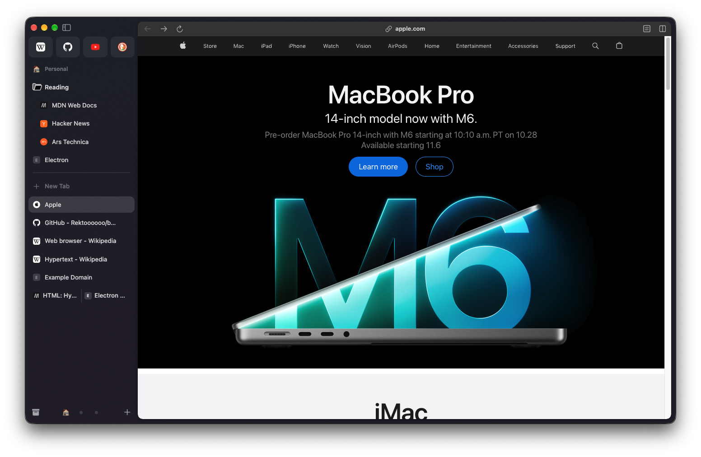
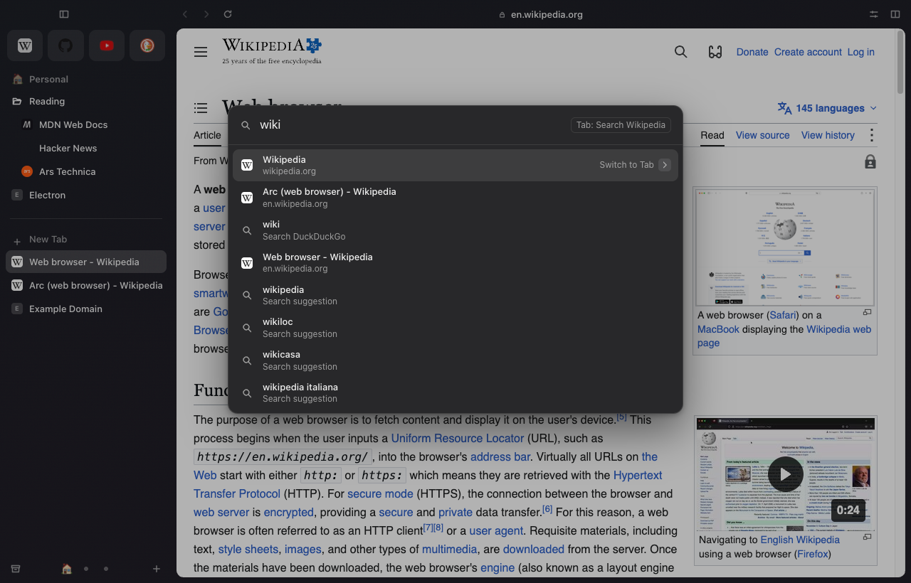

# Sidebar Browser

A desktop browser built with Electron and TypeScript that works like Arc: tabs in a vertical sidebar, Spaces,
Favorites, pinned folders, the page shown as an inset card, a Command Bar, Peek, Split View, Little Windows and
auto-archive for tabs you stop using. It can import your Arc sidebar, archive and history.

Arc is being shut down. Before it goes, we studied how it behaves (from its app bundle and the files it writes;
see [docs/research](docs/research)) and rebuilt that behavior in our own code. No Arc code, icons or assets are used.



## Run it

```bash
nvm use        # Node 24 (see .nvmrc); Node 22.12+ also works
npm install
npm start      # builds, then opens the window
npm test       # unit tests (Vitest)
npm run e2e    # drives the real app with Playwright (opens windows briefly; throwaway profiles)
```

To use it as your everyday browser, build the app and make it the default:

```bash
npm run package   # → release/Sidebar Browser-darwin-arm64/Sidebar Browser.app
```

Move **Sidebar Browser.app** to Applications, open it, and choose **Sidebar Browser › Set as Default Browser…**
(or type "default" in the Command Bar). macOS asks you to confirm. Links from other apps then open in a Little
Window, or in a Space when an Air Traffic Control rule matches. The app is signed ad hoc for this Mac, not
notarized, so copy the built app rather than downloading it elsewhere.

To bring over your Arc setup: **File › Import from Arc…** reads Arc's files on this Mac (read-only) and adds your
Spaces, Favorites, pinned folders and tabs, Today tabs, Space themes, Arc's cached icons, your archive (newest 250),
your browsing history and your Chrome Web Store extensions (copied, so they survive Arc; each keeps the on/off it had
in Arc). Running it twice adds nothing twice.

## What works

**Sidebar**
- Favorites as tiles at the top, shared by every Space that uses the same profile (up to 12, like Arc).
- A Space title (click to collapse Pinned), Pinned tabs and nested folders, a divider with **Clear**, **+ New Tab**,
  and the Today list. A closed folder still shows the tab you are on.
- A Pinned tab that left its page shows Arc's "/" and a button back to its pinned address. ⌘W on a Pinned tab
  puts its page away but keeps the tab.
- Drag and drop: reorder, pin, make a Favorite, drop into a folder, move to another Space, or drop a link to open it.
- Bottom bar: Library, the Space switcher (emoji for the active Space, dots for the others), and a **+** menu.
- ⌘S hides the sidebar; touching the window's left edge shows it again for a moment. Drag its edge to resize it.
- A dot on a Pinned tab or Favorite whose page changed while you were elsewhere (a new mail count), like Arc.
- A small player for a tab playing sound in the background.
- Rest the pointer on a tab to see a preview of its page; ⌃Tab shows the recently used tabs as cards with pictures.
- Pinned tabs show tidy titles ("Inbox" rather than "(3) Inbox - Mail"), our own rules (Library › Settings).
- **Live folders** (+ › New Live Folder) fill themselves, like Arc's: your open GitHub pull requests, review requests
  or assigned issues (read from github.com with the Space's own GitHub sign-in: no token, private repositories
  included), or the posts of the page's RSS/Atom feed. They refresh every 10 minutes; new items get a dot, items
  you remove stay hidden (folder menu › Show Removed Items), the page you are reading never disappears. An Arc
  import keeps Arc's GitHub live folder live.
- The look is measured from Arc pixel by pixel (`node e2e/arc-compare.mjs` puts them side by side): Apple's SF
  Symbols, Arc's frame colors from a Space's theme and intensity, the toolbar inside the page card tinted with the
  page's own color, and motion that glides (the page moves with the sidebar).

**Spaces and profiles**
- Create, rename, change the emoji, edit the theme (one to three colors as a gradient, light / dark / automatic,
  film grain; Space menu › Edit Theme…), reorder, delete. Two-finger swipe on the sidebar or ⌃1–⌃9 switches Spaces.
- Each profile has its own cookies, logins and Favorites (an Electron session partition). Space menu › Profile
  moves a Space to another profile or a new one.
- Private windows (⇧⌘N) keep nothing: an in-memory session, no history, no archive.

**Command Bar** (⌘T, ⌘L)
- Finishes addresses as you type ("git" → github.com, also well-known sites you never visited).
- Open tabs ("Switch to Tab"), history, what you typed, search suggestions and about 40 browser actions
  ("New Space", "Toggle Sidebar", "Copy URL", "Theme: Mint", …), ranked by how well title and address match plus
  boosts for open tabs, Favorites and recent use, the way Arc ranks.

- **Tab to search a site**: type "youtube" (or "wiki", "gh", "maps", "claude", …), press Tab, type your search, Enter.
  Backspace in the empty field goes back. The sites and their search addresses are listed in
  `src/shared/siteSearch.ts`.



**Pages**
- **Peek**: a link from a Pinned tab or Favorite to another site, or any Shift-clicked link, opens in a floating
  card. ⌘O makes it a tab without reloading, Split puts it next to the page, Esc closes it.
- **Split View**: two to four tabs side by side or stacked, one row in the sidebar.
- **Little Window**: links from other apps (and ⌥⌘N) open in a small window; "Open in Space" moves the page into the
  sidebar. A Little Window left alone for 6 hours goes to the Archive.
- **Boosts**: change a site's colors (shift them, or invert for a dark look) and font, Zap elements away, and add
  your own CSS and JavaScript (only once switched on). Turn a Boost off or reset it any time; Library › Boosts.
- **Developer Mode** per site (on by itself for localhost): a striped toolbar with the full address, Console,
  Network and Inspect buttons, a reload menu with Hard Reload, and the tab outlined in yellow.
- **Notes** and **Easels**: rich-text notes and boards (text, drawing, pictures, captures) that sit in the sidebar
  like tabs (File › New Note / New Easel).
- **Ad and tracker blocking** with EasyList and EasyPrivacy (off until you turn it on in Library › Settings), allowed
  per site in the Control Center.
- **Air Traffic Control**: rules such as "address contains github.com → Work" send links from other apps to a Space
  (Library › Settings).
- **Permission prompts**: a site that wants your camera, microphone, location, notifications or clipboard asks
  first ("meet.google.com wants to use your camera and microphone", Block / Allow). The answer is remembered per
  profile and site; the site controls list it with a Reset. Private windows ask every time and remember nothing.
  Links to apps (mailto:, zoommtg:, steam:, …) ask every time and name the app macOS would open.
- The **Control Center** (Arc's site controls): Share, Boost, Screenshot, Capture (drag over part of the page), the
  profile's extensions, per-site settings, and more behind "…" (Translate Page, zoom, clear site data, developer
  tools). Find in page,
  downloads, Print (⌘P), spelling suggestions, a right-click menu in pages, and automatic Picture-in-Picture when
  you leave a tab playing a video.

**Extensions**
- Chrome extensions per profile, like Arc: imported from Arc, added from the Chrome Web Store (open an extension's
  page and click **Add Extension** in the toolbar), or loaded from a folder (Library › Extensions › Load Unpacked…).
  Web Store extensions update by themselves (a minute after start, then every 5 hours, or Check for Updates).
  Each download is checked like Chrome checks it: signed by the extension's own key, before anything is unpacked. Content scripts and Manifest V3 service workers run in Electron itself; the
  [electron-chrome-extensions](https://github.com/samuelmaddock/electron-browser-shell) library (MIT) adds the
  browser parts: the puzzle button in the toolbar opens an extension's popup, `chrome.tabs` knows the selected tab,
  extensions can open tabs, and their items appear in the page's right-click menu.
- Some extensions need Chrome features Electron does not have (side panels, tab capture); those load but only
  partly work.

**Library** (⇧⌘L): the Archive (search, filter by reason, click to restore), History, Media (screenshots and
captures), Downloads, Spaces, Boosts, Extensions and Settings (sounds, ad blocking, app icon, import from Arc,
Chrome, Brave, Edge, Vivaldi or Safari).

**Also**: a short welcome tour on the first start, Handoff of the page you are reading to your other Apple devices,
and alternate app icons for the Dock.

## Auto-archive, like Arc

A Today tab you have not used for 12 hours (the default; 1 hour to 30 days, or never) moves to the Archive. Pinned
tabs and Favorites never do. A tab counts as used while it is on screen, playing sound or in Picture-in-Picture.
These timings match what we measured on a real Arc install. The sweep runs every 5 minutes, the tab on screen is
refreshed every minute, time while the app is closed does not count, and the Archive keeps the newest 250 tabs.
The evidence is in [docs/research/arc-findings.md](docs/research/arc-findings.md#2-auto-archive).

## Keyboard shortcuts

Same keys as Arc. ⌘T new tab, ⌘L edit address, ⌘W close, ⇧⌘T reopen, ⌘D pin/unpin, ⇧⌘C copy URL
(⌥⇧⌘C as Markdown), ⌘S sidebar, ⌘[ / ⌘] back/forward, ⌘R reload, ⌥⌘↑ / ⌥⌘↓ previous/next tab, ⌘1–⌘9 tab N,
⌃Tab / ⌃⇧Tab recent tabs, ⌃⌘N new note, ⌥⌘← / ⌥⌘→ previous/next Space, ⌃1–⌃9 Space N, ⇧⌘K clear Today, ⌃⇧= split view, ⌃⇧- close pane,
⌘O open Peek as tab, ⌥⌘N Little Window, ⌘F find, ⇧⌘L Library, ⌘+ / ⌘- / ⌘0 zoom, ⌥⌘I developer tools.

## How the code is organized

| Folder | Runs in | What it holds |
|---|---|---|
| `src/main` | Electron's main process | State rules (pure functions), web views, menus, overlay panels, Peek, Little Windows, import from Arc |
| `src/renderer` | The sidebar page | The sidebar and toolbar, drawn from the state |
| `src/overlay` | The overlay page | Command Bar, Library, site controls, Find, the Peek frame |
| `src/little` | A Little Window's bar | Address, Copy Link, Open in Space |
| `src/preload` | Before each of our pages loads | The only bridges between our pages and the app |
| `src/shared` | Both | Data types, settings with their sources, message names |
| `tests` | Vitest | Rules for state, Spaces, splits, auto-archive, ranking, history, the Arc importers |
| `e2e` | Playwright + Electron | The real app driven end to end, extensions (with a synthetic test extension), the permission check, the packaged app, the README screenshots |
| `build`, `tools` | — | The app icon (our own drawing) and Info.plist additions; scripts that draw the icon and package the app |
| `docs` | — | Screenshots, `arc-teardown.html` (Arc's 53 features and which are built here), `research/` (findings, Arc's data model, RE setup) |

Three ideas keep it simple:

1. **Pure state functions.** `state.ts`, `spaces.ts`, `split.ts`, `tree.ts` and `autoArchive.ts` take data in and
   return a changed copy. No Electron, no clock.
2. **One way to change state.** `applyChange()` in `browserCore.ts` saves, updates the web views and redraws.
3. **Reconcile, then render.** `syncTabViews()` makes the web views match the state; each page redraws from the
   newest state.

## Security

- Web pages run sandboxed and cannot talk to the app. They get no preload script, except in a profile that has
  extensions: there the extension library's preload runs in an isolated world, so page scripts see nothing new.
  Our own pages only accept their own messages, and every message field is checked.
- Websites get nothing they were not allowed: camera, microphone, location, notifications and clipboard reading
  need the user's Allow (remembered per profile and site), everything else is refused, except full screen and
  clipboard writes. Our own pages are refused without asking. `e2e/permission-check.mjs` proves it.
- Our pages cannot navigate away or open windows, and only load their own scripts.
- Import from Arc only reads Arc's files (its history database through a temporary copy) and never changes them.
